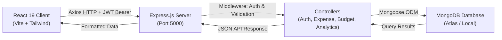

# SpendSmart — Student Expense Tracker


-blue)

-brightgreen)

A full-stack MERN application engineered for college and university students to monitor daily living expenses, manage monthly budget targets, gain visual spending insights, and build sound financial habits.

Developed in compliance with the **ICT Academy of Kerala (ICTAK) MERN Stack Project Guidelines** for internship evaluation.

---

## 1. Problem Statement & Target Users

### Problem Statement
College students frequently struggle with managing their monthly allowances. Irregular expenses across campus canteens, textbooks, hostels, local transport, subscriptions, and social outings often lead to end-of-month financial distress. Existing personal finance applications are either overly complex, require commercial bank integrations, or fail to cater to student-specific expense patterns.

### Target Users
- **Undergraduate & Postgraduate Students**: Living on campus hostels or as day scholars.
- **Interns & Trainees**: Managing fixed monthly stipends and daily commutes.
- **Student Mentors & Academic Evaluators**: Seeking structured financial tracking tools for student guidance.

---

## 2. Key Features

### A. Authentication & Security
- **Secure Registration & Login**: User authentication with email format validation and password length checks.
- **Password Security**: Strong hashing using `bcryptjs` with auto-salted passwords.
- **JWT Session Tokens**: Protected API routes with `Bearer` token verification and automated client-side interceptors.
- **Strict Data Ownership**: Every database query is scoped to the authenticated user ID (`req.user._id`), preventing cross-user data leakage.
- **1-Click Evaluation Demo**: Login page features an instant credential loader for examiners.

### B. Intelligent Dashboard
- **Live Summary Metrics**: Real-time calculation of current month expenses, configured budget, remaining balance, and total transactions.
- **Multi-Stage Budget Warning System**:
  - `Normal` (< 80% of budget spent): Clean green progress badge.
  - `Attention Warning` (80% - 99% spent): Amber caution banner advising spending reduction.
  - `Exceeded Warning` (≥ 100% spent): Prominent red alert banner highlighting over-budget amount.
- **Visual Analytics**: Interactive Recharts donut chart for category distribution and 6-month comparative bar chart.
- **Empty States**: Guidance and call-to-action for new users with zero transactions.

### C. Expense Management
- **Full CRUD Operations**: Create, Read, Update, and Delete expenses.
- **Categorization**: 9 student-tailored categories: `Food`, `Transportation`, `Education`, `Shopping`, `Entertainment`, `Hostel`, `Bills`, `Health`, and `Other`.
- **Search & Filters**: Instant search by description, category filtering, and date range (`startDate` to `endDate`).
- **Sorting & Pagination**: Sort by date or amount (ascending/descending) with clean page controls.
- **Safe Deletion**: Accessible confirmation modal preventing accidental deletions.
- **CSV Data Export**: Download filtered or full expense history as formatted `.csv` spreadsheets.

### D. Monthly Budget Management
- **Custom Budget Limits**: Set monthly allowances for any calendar month and year.
- **Conflict Prevention**: Unique compound index `{ user: 1, month: 1, year: 1 }` prevents duplicate records and supports seamless upsert updates.
- **Historical Tracking**: Review budget performance and adherence across previous academic semesters.

### E. Analytics & Reports
- **Month-over-Month Comparison**: Calculates net difference and percentage change between the current and preceding month.
- **Top Spending Highlights**: Identifies the highest-expenditure category for both the active month and all-time.
- **Custom Period Summaries**: Date-range filtered spending sums and distributions.

### F. User Profile & Settings
- View account creation details and registered student email.
- Update profile name with immediate application-wide synchronization.
- Change password with mandatory verification of current password.

---

## 3. Technology Stack

| Layer | Technology | Purpose |
|---|---|---|
| **Frontend Framework** | React 19 (Vite) | High-performance single page application (SPA) |
| **Styling** | Tailwind CSS v4 | Responsive, modern utility styling & transitions |
| **Icons** | Lucide React | Clean, consistent UI icon library |
| **Data Visualization** | Recharts | Responsive Pie, Donut, and Bar charts |
| **Client Routing** | React Router DOM v7 | Protected routes, layout outlets, navigation |
| **API Client** | Axios | Centralized request client with JWT interceptors |
| **Backend Runtime** | Node.js & Express.js | RESTful API service with modular routing |
| **Database & ODM** | MongoDB & Mongoose 8 | Document storage with schema validations |
| **Authentication** | JWT (`jsonwebtoken`) & `bcryptjs` | Stateless token authorization & password hashing |
| **API Security** | Helmet, CORS, Express-Validator | Security headers, input validation & origin control |
| **Testing** | Jest & Supertest | Automated API endpoint and schema test suite |

---

## 4. MERN Architecture & Request Flow



1. **Client Request**: React triggers an API action through the centralized `services/api.js` module. The Axios request interceptor attaches `Authorization: Bearer <token>`.
2. **Server Routing & Protection**: Express passes the request through `helmet`, `cors`, and `express.json()`. Protected routes invoke `middleware/auth.js` to verify the JWT and attach `req.user`.
3. **Validation & Business Logic**: Input fields are sanitized via `express-validator`. The controller queries MongoDB using Mongoose models.
4. **Data Isolation**: All queries explicitly filter by `user: req.user._id`, ensuring absolute data isolation between students.
5. **Client Rendering**: React receives standardized JSON (`{ success: true, ... }`), updates context/state, and re-renders components.

---

## 5. Project Directory Structure

```text
spend-smart/
├── client/                           # React Frontend (Vite)
│   ├── public/                       # Static public assets
│   ├── src/
│   │   ├── components/               # Reusable UI components
│   │   │   ├── Alert.jsx             # Dismissable alerts (error, warning, success, info)
│   │   │   ├── BudgetProgressBar.jsx # Dynamic multi-tier progress bar
│   │   │   ├── EmptyState.jsx        # First-time user onboarding component
│   │   │   ├── Layout.jsx            # Shell layout with desktop sidebar & mobile drawer
│   │   │   ├── LoadingSpinner.jsx    # Accessible loading states
│   │   │   ├── Modal.jsx             # Accessible modal dialogue
│   │   │   ├── Navbar.jsx            # Responsive header navigation
│   │   │   ├── ProtectedRoute.jsx    # Auth route guards (protected & public)
│   │   │   ├── Sidebar.jsx           # Sidebar navigation with student profile
│   │   │   └── StatCard.jsx          # Dashboard financial metric card
│   │   ├── context/
│   │   │   └── AuthContext.jsx       # Global auth state, session check & token management
│   │   ├── pages/
│   │   │   ├── Analytics.jsx         # Analytics, trends, comparisons & CSV export
│   │   │   ├── Budgets.jsx           # Budget configuration and history
│   │   │   ├── Dashboard.jsx         # Financial dashboard with charts and summary
│   │   │   ├── ExpenseForm.jsx       # Add/Edit expense form with category chips
│   │   │   ├── Login.jsx             # Student login with 1-click evaluator demo
│   │   │   ├── NotFound.jsx          # 404 page
│   │   │   ├── Register.jsx          # Student registration
│   │   │   ├── Settings.jsx          # Profile name update & password change
│   │   │   └── Transactions.jsx      # Transaction table with filters, search, CSV & delete
│   │   ├── services/
│   │   │   └── api.js                # Centralized Axios instance & endpoint catalogue
│   │   ├── utils/
│   │   │   └── constants.js          # Categories, colors, INR formatting, date helpers
│   │   ├── App.jsx                   # React Router routing definition
│   │   ├── index.css                 # Tailwind CSS styles & typography
│   │   └── main.jsx                  # React DOM mount point
│   ├── .env.example                  # Client environment variables template
│   ├── index.html                    # HTML document shell
│   ├── package.json                  # Client dependencies & scripts
│   └── vite.config.js                # Vite build and proxy configuration
├── server/                           # Express.js Backend API
│   ├── src/
│   │   ├── config/
│   │   │   └── db.js                 # MongoDB Mongoose connection handler
│   │   ├── controllers/
│   │   │   ├── analyticsController.js# Dashboard summary, categories, monthly trends
│   │   │   ├── authController.js     # User registration, login, getMe
│   │   │   ├── budgetController.js   # Budget CRUD, calculations, current status
│   │   │   ├── expenseController.js  # Expense CRUD, search, filter, CSV export
│   │   │   └── userController.js     # User profile and password management
│   │   ├── middleware/
│   │   │   ├── auth.js               # JWT verification & ownership protection
│   │   │   ├── errorHandler.js       # Centralized error handler (CastError, 11000, JWT)
│   │   │   └── validate.js           # Express-validator error formatter
│   │   ├── models/
│   │   │   ├── Budget.js             # Budget schema with compound index
│   │   │   ├── Expense.js            # Expense schema with category enum
│   │   │   └── User.js               # User schema with bcrypt pre-save hook
│   │   ├── routes/
│   │   │   ├── analyticsRoutes.js    # /api/analytics endpoints
│   │   │   ├── authRoutes.js         # /api/auth endpoints
│   │   │   ├── budgetRoutes.js       # /api/budgets endpoints
│   │   │   ├── expenseRoutes.js      # /api/expenses endpoints
│   │   │   └── userRoutes.js         # /api/users endpoints
│   │   ├── utils/
│   │   │   └── seed.js               # Database seeder with sample student records
│   │   ├── app.js                    # Express app configuration & middleware mounts
│   │   └── server.js                 # Server startup and port listener
│   ├── tests/
│   │   └── api.test.js               # Automated Jest & Supertest test suite
│   ├── .env.example                  # Server environment variables template
│   ├── package.json                  # Server dependencies, scripts & Jest config
│   └── postman_collection.json       # Ready-to-import Postman / Thunder Client collection
├── .gitignore                        # Global ignore for node_modules, .env, build output
├── package.json                      # Root convenience runner
└── README.md                         # Comprehensive documentation
```

---

## 6. Database Models

### User Schema (`server/src/models/User.js`)
| Field | Type | Attributes | Description |
|---|---|---|---|
| `name` | String | Required, Trim, Max: 50 | Student full name |
| `email` | String | Required, Unique, Lowercase, Match Regex | Student college email |
| `password` | String | Required, Min: 6 | Bcrypt hashed password |
| `timestamps` | Date | `createdAt`, `updatedAt` | Auto-managed by Mongoose |

### Expense Schema (`server/src/models/Expense.js`)
| Field | Type | Attributes | Description |
|---|---|---|---|
| `user` | ObjectId | Required, Ref: 'User', Indexed | Owner reference |
| `amount` | Number | Required, Min: 0.01 | Expense amount in INR |
| `category` | String | Required, Enum (9 categories) | Expense category |
| `date` | Date | Required, Default: `Date.now` | Date expense occurred |
| `description` | String | Required, Trim, Max: 200 | Note / reason for expense |
| `timestamps` | Date | `createdAt`, `updatedAt` | Auto-managed by Mongoose |

*Index*: `{ user: 1, date: -1 }` for high-performance timeline queries.

### Budget Schema (`server/src/models/Budget.js`)
| Field | Type | Attributes | Description |
|---|---|---|---|
| `user` | ObjectId | Required, Ref: 'User', Indexed | Owner reference |
| `month` | Number | Required, Min: 1, Max: 12 | Calendar month |
| `year` | Number | Required, Min: 2000, Max: 2100 | Calendar year |
| `amount` | Number | Required, Min: 0.01 | Planned spending ceiling in INR |
| `timestamps` | Date | `createdAt`, `updatedAt` | Auto-managed by Mongoose |

*Compound Unique Index*: `{ user: 1, month: 1, year: 1 }` prevents duplicate records for the same month and user.

---

## 7. RESTful API Endpoints

All endpoints are prefixed with `/api`. Protected routes require header: `Authorization: Bearer <jwt_token>`.

### Authentication Endpoints
| Method | Endpoint | Access | Description | Status Codes |
|---|---|---|---|---|
| `POST` | `/api/auth/register` | Public | Register new student account | `201`, `400`, `409` |
| `POST` | `/api/auth/login` | Public | Authenticate user & get JWT | `200`, `400`, `401` |
| `GET` | `/api/auth/me` | Protected | Get current authenticated user | `200`, `401` |

### Expense Endpoints
| Method | Endpoint | Access | Description | Status Codes |
|---|---|---|---|---|
| `GET` | `/api/expenses` | Protected | Get expenses with search, filter, sort & pagination | `200`, `401` |
| `POST` | `/api/expenses` | Protected | Create a new expense record | `201`, `400`, `401` |
| `GET` | `/api/expenses/:id` | Protected | Get single expense (ownership enforced) | `200`, `401`, `403`, `404` |
| `PATCH` | `/api/expenses/:id` | Protected | Update expense (ownership enforced) | `200`, `400`, `401`, `403`, `404` |
| `DELETE` | `/api/expenses/:id` | Protected | Delete expense (ownership enforced) | `200`, `401`, `403`, `404` |
| `GET` | `/api/expenses/export/csv` | Protected | Export filtered expenses as downloadable CSV | `200`, `401` |

### Budget Endpoints
| Method | Endpoint | Access | Description | Status Codes |
|---|---|---|---|---|
| `GET` | `/api/budgets` | Protected | Get all budgets for user with computed spent & status | `200`, `401` |
| `GET` | `/api/budgets/current` | Protected | Get current month budget with live calculations | `200`, `401` |
| `POST` | `/api/budgets` | Protected | Create or update budget for specified month & year | `201`, `400`, `401` |
| `PATCH` | `/api/budgets/:id` | Protected | Update budget amount by ID | `200`, `400`, `401`, `403`, `404` |

### Analytics Endpoints
| Method | Endpoint | Access | Description | Status Codes |
|---|---|---|---|---|
| `GET` | `/api/analytics/summary` | Protected | Current month totals, budget status & recent 5 items | `200`, `401` |
| `GET` | `/api/analytics/categories`| Protected | Category breakdown with amounts & percentages | `200`, `401` |
| `GET` | `/api/analytics/monthly` | Protected | 6-month trends, MoM comparison & top category | `200`, `401` |

### User Profile Endpoints
| Method | Endpoint | Access | Description | Status Codes |
|---|---|---|---|---|
| `GET` | `/api/users/me` | Protected | Get user account details | `200`, `401` |
| `PATCH` | `/api/users/me` | Protected | Update user profile name and/or password | `200`, `400`, `401` |

---

## 8. Installation & Setup Instructions

### Prerequisites
- [Node.js](https://nodejs.org/) (v18 or higher recommended; v24 supported)
- [MongoDB](https://www.mongodb.com/) (Local Community Server on port 27017 or a free [MongoDB Atlas](https://www.mongodb.com/cloud/atlas) cluster)
- [Git](https://git-scm.com/)

### Step 1: Clone or Navigate to Project
```bash
git clone https://github.com/your-username/spend-smart.git
cd spend-smart
```

### Step 2: Install All Dependencies
You can install dependencies for both frontend and backend using the root command:
```bash
npm run install:all
```
*Or manually in each subfolder:*
```bash
cd server && npm install
cd ../client && npm install
```

### Step 3: Configure Environment Variables

**Backend (`server/.env`):**
Create `server/.env` from `server/.env.example`:
```env
PORT=5000
NODE_ENV=development
MONGODB_URI=mongodb://127.0.0.1:27017/spend-smart
JWT_SECRET=spendsmart_jwt_super_secret_internship_key_2026
JWT_EXPIRES_IN=7d
CLIENT_URL=http://localhost:5173
```
*(If using MongoDB Atlas, replace `MONGODB_URI` with your connection string: `mongodb+srv://<username>:<password>@cluster0.mongodb.net/spend-smart?retryWrites=true&w=majority`)*

**Frontend (`client/.env`):**
Create `client/.env` from `client/.env.example`:
```env
VITE_API_URL=http://localhost:5000/api
```

### Step 4: (Optional) Seed Sample Evaluation Data
To seed a realistic student demo account with sample expenses and budgets:
```bash
npm run seed
```
*(Creates `student@ictak.edu` with password `student123`)*

---

## 9. Running the Application

### Option A: Running with Root Scripts
Open two terminal windows in the `spend-smart` root folder:

**Terminal 1 (Backend API):**
```bash
npm run server
```
Server runs on: `http://localhost:5000` (Healthcheck: `http://localhost:5000/api/health`)

**Terminal 2 (Frontend Client):**
```bash
npm run client
```
Client runs on: `http://localhost:5173`

---

## 10. Automated Testing & Postman Checklist

### Automated Unit & API Tests
Run the comprehensive test suite with Jest and Supertest:
```bash
npm run test:server
```
**Test Results:**
- `GET /api/health` returns status 200
- 404 handler for unknown routes
- Registration validation (missing fields, invalid email, weak password)
- Login validation (missing credentials)
- JWT signature & token expiration validation
- `protect` middleware rejecting missing or malformed tokens
- Expense validation (rejection of zero or negative amounts)
- Category enum enforcement
- Budget validation (month out of 1-12 bounds)
- User schema `toJSON` password security masking

### Manual Testing with Postman / Thunder Client
Import `server/postman_collection.json` into Postman or VS Code Thunder Client:
1. Call `Health Check` -> Verify status `ok`.
2. Call `Auth - Register` or `Auth - Login` -> Copy the returned `token`.
3. Set the collection variable `authToken` to the token.
4. Execute `Budgets - Set Monthly Budget`, `Expenses - Create Expense`, and `Analytics - Dashboard Summary`.
5. Verify response payload and status codes.

---

## 11. Production Build & Deployment Instructions

### Production Build Verification
The client has been verified to build cleanly for production:
```bash
npm run build:client
```
Output is generated in `client/dist/`.

### Deployment Instructions

#### 1. Database (MongoDB Atlas)
1. Create a free cluster on [MongoDB Atlas](https://www.mongodb.com/cloud/atlas).
2. Create a database user with read/write access.
3. In Network Access, whitelist the required IP addresses (or `0.0.0.0/0` for cloud providers).
4. Copy the connection URI for the backend environment variable `MONGODB_URI`.

#### 2. Backend (Render / Railway / Heroku)
1. Connect the GitHub repository.
2. Set Root Directory to `server`.
3. Set Build Command to: `npm install`
4. Set Start Command to: `npm start`
5. Configure Environment Variables in the hosting dashboard:
   - `PORT=5000`
   - `NODE_ENV=production`
   - `MONGODB_URI=<your_mongodb_atlas_uri>`
   - `JWT_SECRET=<strong_random_secret>`
   - `CLIENT_URL=https://your-frontend.vercel.app`

#### 3. Frontend (Vercel / Netlify)
1. Connect the repository.
2. Set Root Directory to `client`.
3. Build Command: `npm run build`
4. Output Directory: `dist`
5. Configure Environment Variable:
   - `VITE_API_URL=https://your-backend.onrender.com/api`

---

## 12. Known Limitations & Future Enhancements

### Known Limitations
- Current version supports single-currency format (Indian Rupee - INR ₹).
- Receipts are currently entered textually; file upload / camera OCR for canteen paper bills is not yet implemented.

### Future Enhancements
- **Split Bills with Roommates**: Equal and unequal split calculations among hostel roommates.
- **Push & Email Notifications**: Automated reminder when approaching 90% of the budget.
- **Recurring Subscriptions Tracker**: Automated tracking for student tools (Spotify, GitHub, OTT).
- **PWA Support**: Offline-first caching for mobile browser installation.

---

## 13. ICTAK Project Evaluation Checklist

| Requirement | Implementation Status | Location |
|---|---|---|
| User Registration & Login | Completed | `server/src/controllers/authController.js`, `client/src/pages/Login.jsx` |
| Password Hashing | Completed (`bcryptjs`) | `server/src/models/User.js` |
| Protected API Routes | Completed (`jwt`) | `server/src/middleware/auth.js`, `client/src/components/ProtectedRoute.jsx` |
| User Ownership Verification | Completed | Checked in every controller query |
| Responsive Dashboard | Completed | `client/src/pages/Dashboard.jsx` |
| Visual Charts | Completed (`recharts`) | Donut and Bar charts in Dashboard & Analytics |
| Budget Warnings (80% / Exceeded) | Completed | `client/src/components/BudgetProgressBar.jsx` |
| Expense Search, Filter & Sort | Completed | `client/src/pages/Transactions.jsx` |
| CSV Report Export | Completed | `server/src/controllers/expenseController.js`, `client/src/pages/Transactions.jsx` |
| Centralized API Module | Completed | `client/src/services/api.js` |
| Production Build Verified | Completed | `vite build` creates bundle in `client/dist` |
| Automated Testing | Completed (13 tests) | `server/tests/api.test.js` |
| Environment Config (.env.example) | Completed | `server/.env.example`, `client/.env.example` |

---

*SpendSmart is developed by an ICTAK MERN Stack Intern for academic internship evaluation.*
